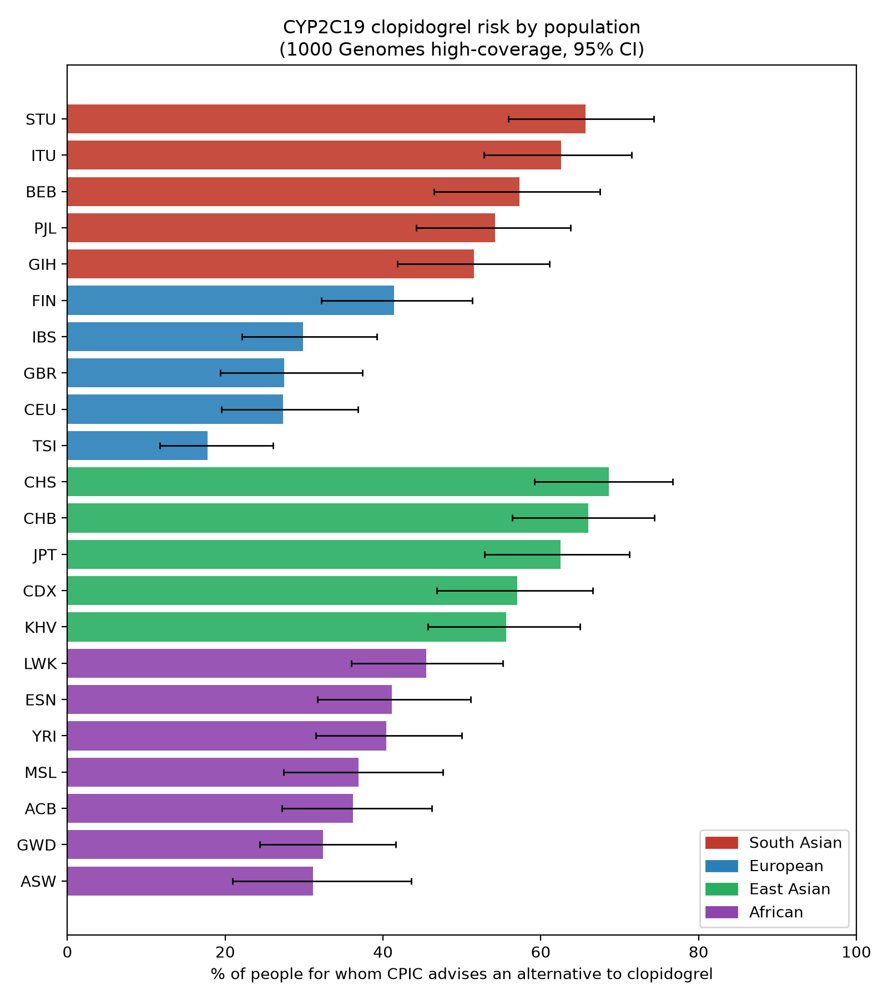
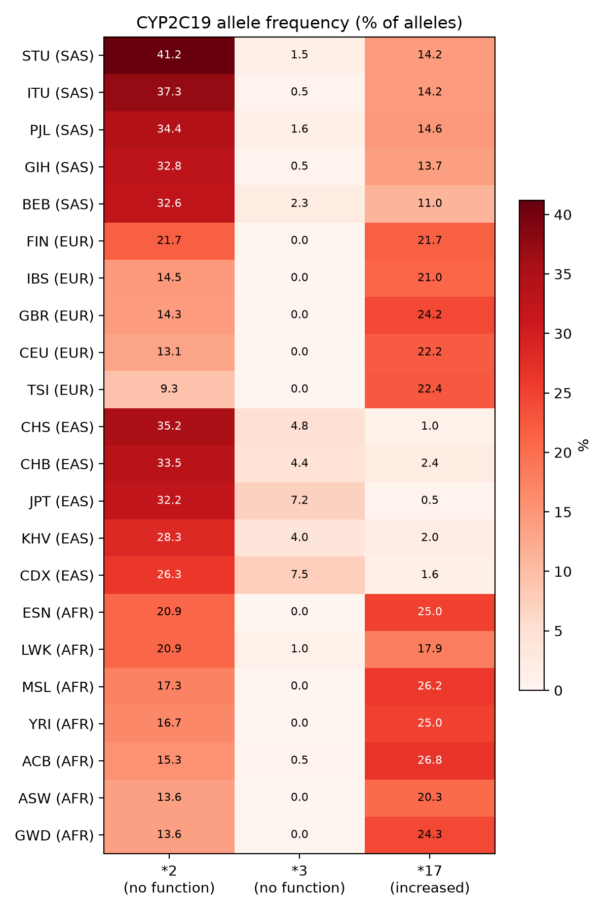

# CYP2C19 and clopidogrel: how many people in South Asian populations would be advised an alternative drug?

A reproducible pharmacogenomics analysis using public whole-genome data from the 1000 Genomes Project. It estimates, for each population, the percentage of people whose CYP2C19 genotype leads CPIC to advise an alternative to clopidogrel, and compares five South Asian populations with European, East Asian and African populations.

Author: Shriya A.N.

## Question

CYP2C19 activates the antiplatelet drug clopidogrel. People who carry loss-of-function alleles (such as \*2 and \*3) make less active drug and are at higher risk of cardiovascular events. CPIC guidelines recommend an alternative (prasugrel or ticagrelor) for intermediate and poor metabolizers who have had a heart attack or stent. South Asian populations are often treated as one group in PGx studies, so this project reports the five 1000 Genomes South Asian populations (BEB, GIH, ITU, PJL, STU) separately.

## Key results

| Group | People classified | Advised an alternative |
|---|---|---|
| South Asian (pooled, 5 populations) | 475 | **58.3%** (277) |
| European (pooled, 5 populations) | 503 | 28.6% (144) |

- South Asians vs Europeans: odds ratio **3.49** (95% CI 2.67 to 4.55), Benjamini-Hochberg adjusted p = 5.3e-20.
- South Asians vs Africans: OR 2.29 (95% CI 1.80 to 2.91), adjusted p = 4.2e-11.
- South Asians vs East Asians: OR 0.85 (95% CI 0.66 to 1.10), adjusted p = 0.24 (no significant difference).
- All five South Asian populations differ significantly from Europeans after correction (OR 2.65 to 4.77).

| South Asian population | % advised an alternative (95% CI) |
|---|---|
| STU | 65.7 (55.9 to 74.3) |
| ITU | 62.6 (52.8 to 71.5) |
| BEB | 57.3 (46.5 to 67.5) |
| PJL | 54.2 (44.2 to 63.8) |
| GIH | 51.5 (41.8 to 61.1) |

The confidence intervals overlap, so differences between individual South Asian populations are not established by these data.



### Why: allele frequencies

The \*2 no-function allele is common in the South Asian populations (32.6% to 41.2% of alleles, versus 9.3% to 21.7% in Europeans). The \*3 allele is rare in South Asians (0.5% to 2.3%) but present in East Asians (4.0% to 7.5%), and the increased-function \*17 allele is lower in South Asians (11.0% to 14.6%) than in Europeans (21.0% to 24.2%).



## Data

- **Genotypes:** 1000 Genomes high-coverage (30x) whole-genome data from the New York Genome Center, GRCh38, phased SNV/INDEL/SV VCF for chromosome 10 (Byrska-Bishop et al., Cell 2022).
- **Samples:** the 2,157 unrelated individuals from the phase 3 panel in the South Asian, European, East Asian and African super-populations (admixed American samples were not used).
- **Region:** chr10:94,700,000-94,900,000 (GRCh38), a window around CYP2C19.

The large input files are not stored in this repository. See "How to reproduce".

## Methods

1. Extracted the CYP2C19 region and the selected samples with `bcftools`.
2. Cleaned the VCF with the PharmCAT VCF preprocessor (v3.4.0).
3. Called star-allele diplotypes, phenotypes and guideline recommendations with PharmCAT v3.4.0.
4. Combined the per-person results into one table and grouped people as "alternative advised" (intermediate, poor, likely intermediate, likely poor), "no alternative" (normal, rapid, ultrarapid) or "not classifiable".
5. Calculated percentages with Wilson 95% confidence intervals, tested differences with Fisher's exact test, and corrected for multiple testing with the Benjamini-Hochberg method (`scripts/analysis.py`).
6. Calculated allele frequencies per population (`scripts/allele_freq.py`).

## How to reproduce

Requirements: Linux or WSL, `bcftools`, Java, Python 3 with `pandas`, `scipy` and `matplotlib`, and PharmCAT 3.4.0 (https://github.com/PharmGKB/PharmCAT/releases).

```bash
# 1. Population labels (phase 3 panel file) and sample list
#    save the panel file as panel.txt, then:
awk 'NR>1 && ($3=="SAS"||$3=="EUR"||$3=="EAS"||$3=="AFR"){print $1}' panel.txt > samples.txt

# 2. Extract the CYP2C19 region
URL=https://ftp.1000genomes.ebi.ac.uk/vol1/ftp/data_collections/1000G_2504_high_coverage/working/20220422_3202_phased_SNV_INDEL_SV/1kGP_high_coverage_Illumina.chr10.filtered.SNV_INDEL_SV_phased_panel.vcf.gz
bcftools view -r chr10:94700000-94900000 -S samples.txt $URL -Oz -o cyp2c19_region.vcf.gz
bcftools index -t cyp2c19_region.vcf.gz

# 3. PharmCAT
./pharmcat_vcf_preprocessor -vcf cyp2c19_region.vcf.gz -o full_pre
java -jar pharmcat.jar -vcf full_pre/cyp2c19_region.vcf.preprocessed.vcf.bgz -reporterCallsOnlyTsv -del -o full_out

# 4. Combine per-person CYP2C19 calls into one table
for f in full_out/*.report.tsv; do s=$(basename "$f" .report.tsv); s=${s##*.}; grep -h "^CYP2C19" "$f" | sed "s/^/$s\t/"; done > cyp2c19_calls.tsv
```

Step 5 (building `cyp2c19_final.tsv`, which adds population labels and the three groups) was done with an `awk` command; see `results/cyp2c19_final.tsv` for its output format (columns: sample, pop, super_pop, diplotype, phenotype, group). Then run:

```bash
python3 scripts/analysis.py
python3 scripts/allele_freq.py
```

## Limitations

- 1000 Genomes participants are healthy volunteers, not patients taking clopidogrel. The percentages are the share of people for whom an alternative would be advised if they needed the drug, not observed outcomes.
- Each population has about 100 people, so confidence intervals are wide (roughly 10 percentage points either side).
- 27 people (1.3%) could not be classified and were excluded from percentages: 3 with no CYP2C19 call, 11 with an indeterminate phenotype (carriers of \*39, which has uncertain function) and 13 \*40 carriers (unassigned function). The 13 \*40 carriers are all in South Asian populations, so the South Asian percentages may be slightly conservative if \*40 reduces function. This has not been confirmed.
- The recommendation applies to specific clinical indications (such as acute coronary syndrome or stent placement).
- Population labels are sampling categories, not strict genetic groups.
- CYP2C19 was called from a VCF containing only the CYP2C19 region; no structural-variant or second-caller check was done.

## Not for clinical use

This is a research and learning project. It must not be used to make prescribing decisions.

## References

- Byrska-Bishop M, et al. High-coverage whole-genome sequencing of the expanded 1000 Genomes Project cohort including 602 trios. Cell 2022. https://doi.org/10.1016/j.cell.2022.08.004
- PharmCAT: https://pharmcat.org (Sangkuhl K, et al. Clin Pharmacol Ther 2020)
- CPIC guideline for CYP2C19 and clopidogrel: https://cpicpgx.org
